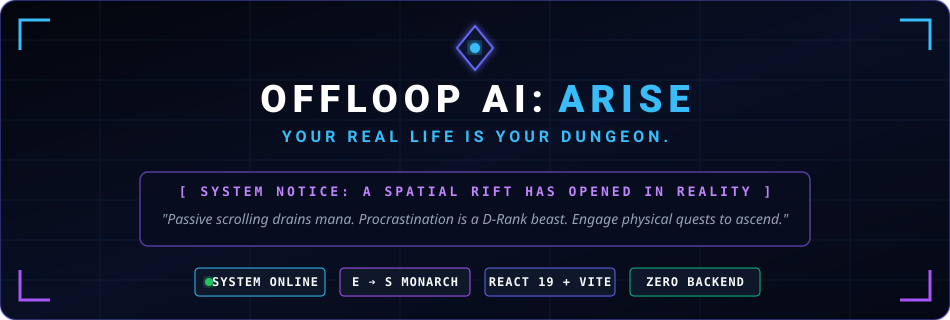
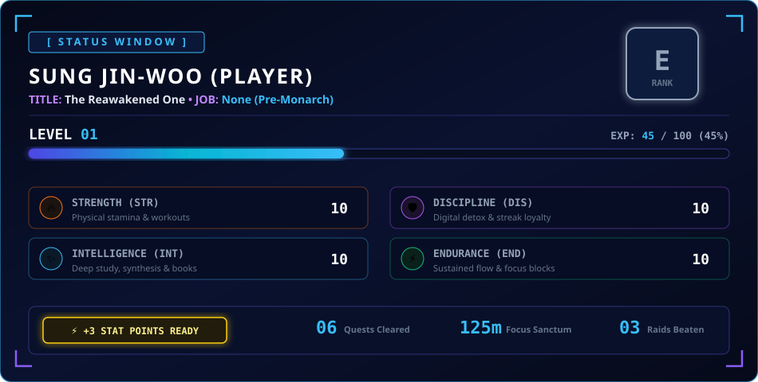
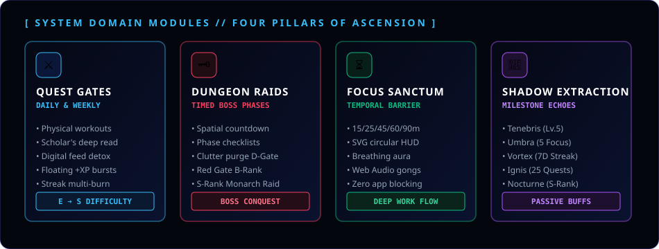
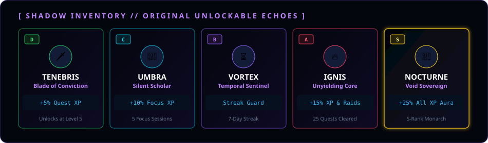

<div align="center">



<br/><br/>

[](https://offloop-ai-arise.onrender.com/)
[](https://github.com/shettysaikumar20/offloop-ai-arise/actions/workflows/web-ci.yml)
[](https://github.com/shettysaikumar20/offloop-ai-arise/actions/workflows/backend-ci.yml)
[](#)
[](#)
[](#)
[](#)

</div>

<br/>

> [!TIP]
> ### 🌐 Live System Portal (Instant Access)
> **Direct Link:** **[https://offloop-ai-arise.onrender.com/](https://offloop-ai-arise.onrender.com/)**  
> *Enter the System directly in your browser. Complete the Hunter Awakening Ceremony, battle procrastination dungeons, and progress through the Hunter ranks.*

<br/>

> [!IMPORTANT]
> **SYSTEM NOTICE: CANDIDATE DETECTED**  
> *Passive scrolling drains mana. Procrastination is a D-Rank beast. Engage physical world quests to restore vitality and ascend to the throne of the Monarch.*

---

## 🌌 The Concept

**OffLoop AI: ARISE** is a desktop-first quest, productivity, and self-improvement web application inspired by the supernatural **"System"** interface from *Solo Leveling*. 

It transforms your daily real-world chores, deep study sessions, physical workouts, and digital detox habits into high-stakes **Hunter Quests**, **Dungeon Raids**, and **Rank Promotions** — running 100% locally in your browser with zero bloat and zero telemetry.

<br/>

<div align="center">
  
</div>

<br/>

---

## 🔮 The Four Pillars of Ascension

<div align="center">
  
</div>

<br/>

### 1. ⚔️ Quest Gates & Real-World Missions
- **Daily Conditioning Protocols**: Physical pushups, scholar's non-fiction reading, digital feed detox, unbroken deep work strikes.
- **Weekly Gates**: Extended trials that test consistency across multiple consecutive days.
- **Custom Quest Creation**: Register your own real-world tasks with custom difficulties (**E / D / C / B / A / S**), attribute bonuses, and XP bounties.
- **Floating Reward Burst**: Completing a quest launches an animated `+XP` indicator with a neon emerald/blue flash and audio confirmation.

### 2. 🗝️ Dungeon Challenges (Productivity Raids)
Timed, multi-phase boss missions designed to defeat real-world procrastination before the clock expires:
- **Gate of the Cluttered Chamber (D-Rank — 25 Min)**: Clear desk, hydration & airflow, digital tab purge.
- **Red Gate: The Procrastination Labyrinth (B-Rank — 45 Min)**: Identify dread task, break into angles, strike down the deliverable.
- **Monarch's Citadel of Transcendent Craft (S-Rank — 75 Min)**: Full sensory lockdown, blueprint design, deep work surges.

### 3. ⏳ Focus Sanctum (Pomodoro Temporal Barrier)
- **Presets**: 15m Sprint, 25m Pomodoro, 45m Deep Work, 60m Flow Block, 90m Monastic.
- **Hardware-Accelerated Circular Timer**: SVG circular countdown with animated stroke dashoffset and calm breathing aura.
- **Session History Log**: Automatic tracking of focus minutes, task titles, and XP rewards.
- **Pure Local Execution**: Zero blocking of other Windows apps.

### 4. 👥 Shadow Companions & Echoes
Original unlockable companion manifestations born from past self-discipline:

<br/>

<div align="center">
  
</div>

<br/>

---

## 🌟 First-Time Hunter Awakening Protocol

When a new user launches **OffLoop AI: ARISE**, the System initiates a staged 3-step RPG awakening ritual:

1. **The Summons**: The System intercepts passive scrolling habits and presents the call to become a real-world Hunter.
2. **Hunter Registration**: Enter your custom Hunter Name (*e.g., Sung Jin-Woo*) and Moniker/Title (*e.g., The Reawakened One*).
3. **Discipline Path Selection**: Choose your starting focus:
   - 🛡️ **Iron Will & Digital Detox** (+2 Discipline bonus)
   - 🗡️ **Physical Vessel Awakening** (+2 Strength bonus)
   - 🔮 **Arcane Architect & Scholar** (+2 Intelligence bonus)
   - ⚡ **Temporal Sentinel** (+2 Endurance bonus)
4. **Initiation Rewards**: Grants your customized first E-Rank Awakening Quest and **+75 starting XP**.
5. *You can skip the awakening ritual or replay it anytime from System Settings.*

---

## 🎬 Solo Leveling Cinematic Animations

Engineered specifically for low-power laptops (**Intel i3-6006U, 8 GB RAM**):

| Animation | Implementation | Performance |
|---|---|---|
| **System Awakening** | Translucent obsidian modal reveal with glowing violet borders | Pure CSS transform |
| **Floating XP Rewards** | `+150 XP` floats upward and fades away on quest claim | GPU-accelerated translate3d |
| **Quest Completion Flash** | Border glow pulse in electric emerald & blue | Lightweight CSS keyframe |
| **Rank Promotion Ring** | Expanding energy-ring pseudo-element (`.rank-energy-ring`) | Pure CSS, 0% CPU leak |
| **Dungeon Portal Entry** | Spatial swirl and scale transition on gate opening | 0.38s CSS transform |
| **Focus Breathing Timer** | Animated SVG `stroke-dashoffset` circle with aura pulse | Pauses when timer pauses |
| **Achievement Shimmer** | Diagonal light sweep across unlocked achievement badges | Hardware-accelerated gradient |
| **Tactile Buttons** | Micro-scale compression on click (`:active`) | Zero layout reflow |

> [!NOTE]  
> All animations respect `@media (prefers-reduced-motion: reduce)` for complete accessibility.

---

## 🏗️ Repository Architecture

```
offloop-ai-arise/
├── assets/                    # Solo Leveling System SVG visual cards & banners
│   ├── header_banner.svg      # Cinematic obsidian header banner
│   ├── system_status_window.svg # Full Hunter Status HUD card
│   ├── features_cards.svg     # Four Pillars of Ascension card
│   └── shadow_legion.svg      # Shadow Inventory showcase card
├── frontend/                  # Desktop Web Application
│   ├── src/
│   │   ├── components/        # Status, Quests, Dungeons, Focus Sanctum, Shadows, Achievements
│   │   ├── context/           # SystemContext reactive state engine
│   │   ├── types/             # Models, Ranks (E->S), Quests, Shadows, Stats
│   │   ├── utils/             # LocalStorage manager, Web Audio synthesis, Self-tests
│   │   ├── App.jsx            # Master layout with view transitions
│   │   ├── index.css          # Dark fantasy System stylesheet & animations
│   │   └── main.jsx           # React DOM root
│   ├── test-mechanics.js      # Headless Node.js automated test runner (25 tests)
│   ├── index.html             # HTML shell with Orbitron & Rajdhani fonts
│   ├── vite.config.js         # Vite configuration
│   └── package.json           # Minimal dependencies (React 19, Lucide, Vite)
├── backend/                   # Optional FastAPI Backend (Python 3.11+)
├── scripts/                   # run_web.ps1, run_web.sh
└── .gitignore                 # Clean repository exclusions
```

---

## 🧠 Where & How the AI Works

The AI system in **OffLoop AI: ARISE** is architected across two complementary environments:

```
┌────────────────────────────────────────────────────────────────────────┐
│                   OFFLOOP AI: ARISE ARCHITECTURE                       │
├───────────────────────────────────┬────────────────────────────────────┤
│   🌐 LIVE WEB PORTAL (Render)     │    ⚡ FASTAPI AI BACKEND (Local)   │
│   https://offloop-ai-arise...     │    http://localhost:8000           │
├───────────────────────────────────┼────────────────────────────────────┤
│ • Client-Side System Engine       │ • Local Open-Weight Models (Ollama)│
│ • Zero Latency, 100% Privacy      │   - Google Gemma 2 2.6B (Active)   │
│ • Deterministic RPG & Rank Math   │   - Google Gemma 3 4.3B (Supported)│
│ • Focus Sanctum & Audio FX        │ • Hosted Gemma Remote Endpoints    │
│ • Works completely offline        │ • Deterministic Template Failover  │
└───────────────────────────────────┴────────────────────────────────────┘
```

### 1. 🌐 On the Live Web App ([https://offloop-ai-arise.onrender.com/](https://offloop-ai-arise.onrender.com/))
- **Edge / Browser Execution**: The live deployment is hosted on Render as a high-speed Single Page Application.
- **Client-Side Game Loop**: The Hunter Awakening ceremony, daily training protocols, penalty countdown timer, stat attribute allocations (`STR`, `AGI`, `INT`, `VIT`, `PER`), and Web Audio synthesis run entirely inside your browser using `localStorage`.
- **Zero Latency & Privacy**: No personal habits, timer logs, or productivity data leave your device.

### 2. ⚡ In the FastAPI Backend (`backend/`)
- **Local Open-Weight Model Engine**: Connects to **Ollama** (`http://localhost:11434`) running **Google Gemma 2** (`gemma2:2b`). Generates procedural real-world exploration quests using live OpenStreetMap POI data (parks, historic monuments, botanical gardens, trails).
- **Remote Model Support**: Compatible with OpenAI-compatible hosted Gemma endpoints (`google/gemma-2-9b-it`).
- **Resilient 3-Tier Fallback**: If Ollama or the local model is offline (e.g. inside GitHub Actions runners or cloud environments without local GPUs), the service automatically falls back in milliseconds to the built-in deterministic quest architect without throwing errors.

---

## 🚀 Quick Start Guide

### Prerequisites
- Node.js 18+ (for Web Frontend)
- Python 3.11+ (optional, for FastAPI Backend)
- Ollama (optional, for running local open-weight Gemma models)

### 1. Launch the Web Application
```bash
# Clone the repository
git clone https://github.com/shettysaikumar20/offloop-ai-arise.git
cd offloop-ai-arise/frontend

# Install dependencies
npm install

# Start development server
npm run dev
```

Or run the convenient root runner script:
```powershell
# Windows PowerShell
.\scripts\run_web.ps1
```
```bash
# Linux / macOS
chmod +x ./scripts/run_web.sh && ./scripts/run_web.sh
```

Open your browser to: **[http://localhost:5173](http://localhost:5173)** or visit the **[Live Portal](https://offloop-ai-arise.onrender.com/)**.

### 2. Launch the AI Backend with Local Open-Weight Model (Optional)
```bash
# 1. Start Ollama with Gemma 2
ollama run gemma2:2b

# 2. Start FastAPI Backend
cd offloop-ai-arise/backend
pip install -r requirements.txt
uvicorn app.main:app --reload --port 8000
```
- API Docs: **[http://localhost:8000/docs](http://localhost:8000/docs)**
- Health Check: **[http://localhost:8000/api/v1/health](http://localhost:8000/api/v1/health)**

---

## 🧪 Testing & Verification

The project includes an automated test runner validating all RPG calculations:

```bash
cd frontend
npm test
```

```
====================================================
⚡ STARTING OFFLOOP AI: ARISE AUTOMATED TEST SUITE
====================================================
✅ [PASS] Level 1-4 resolves to E-Rank
✅ [PASS] Level 5-9 resolves to D-Rank
✅ [PASS] Level 10 resolves to C-Rank
✅ [PASS] Level 20 resolves to B-Rank
✅ [PASS] Level 35 resolves to A-Rank
✅ [PASS] Level 50 resolves to S-Rank Monarch
✅ [PASS] Level 1 requires 100 XP to advance
✅ [PASS] Level 2 requires more XP than Level 1
✅ [PASS] XP requirements scale consistently across levels
✅ [PASS] 100 XP triggers Level 2 and awards +3 stat points
✅ [PASS] 2000 XP ascends player to Level 10+ and C-Rank
✅ [PASS] Allocating point decrements available points and increases STR
✅ [PASS] Initial quest library populated with dailies and weeklies
✅ [PASS] Three multi-phase Dungeon Gates defined
✅ [PASS] Five original Shadow Companions configured
✅ [PASS] Hunter Feats / Achievements library defined
✅ [PASS] Full state passes JSON import schema validation
✅ [PASS] Empty payload fails validation
✅ [PASS] Null payload safely rejected
✅ [PASS] Tenebris extracts at Level 5
✅ [PASS] Umbra extracts at 5 Focus Sessions
✅ [PASS] Vortex extracts at 7-Day Streak
✅ [PASS] Ignis extracts at 25 Quests Completed
✅ [PASS] Fresh state initializes with awakened=false for onboarding
✅ [PASS] Default Hunter name is properly registered
====================================================
🏁 TEST RESULTS: 25/25 TESTS PASSED (0 FAILED)
====================================================
```

### Production Build Verification
```bash
cd frontend
npm run build
```
Outputs a compact, highly optimized bundle:
- CSS: `~10.9 kB` (`3.2 kB` gzip)
- JS: `~351 kB` (`100 kB` gzip)
- Build time: `< 12 seconds`

---

## 📄 License

This project is licensed under the [MIT License](LICENSE).
